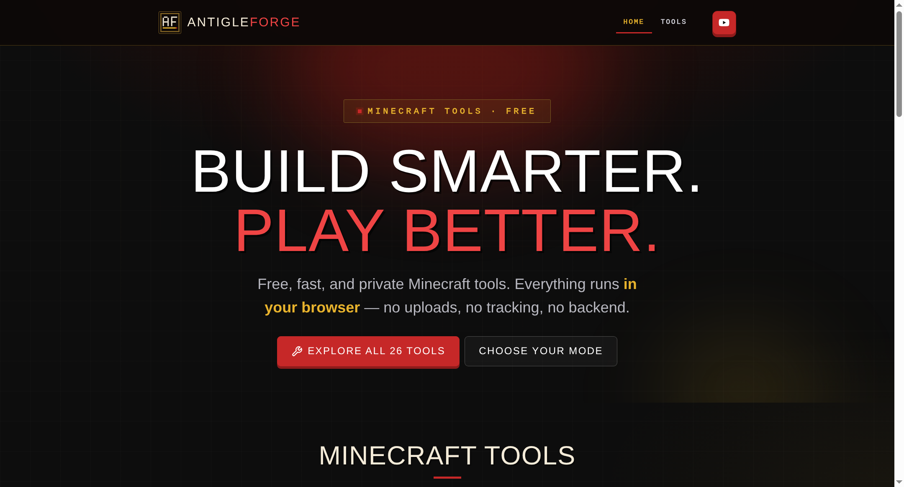
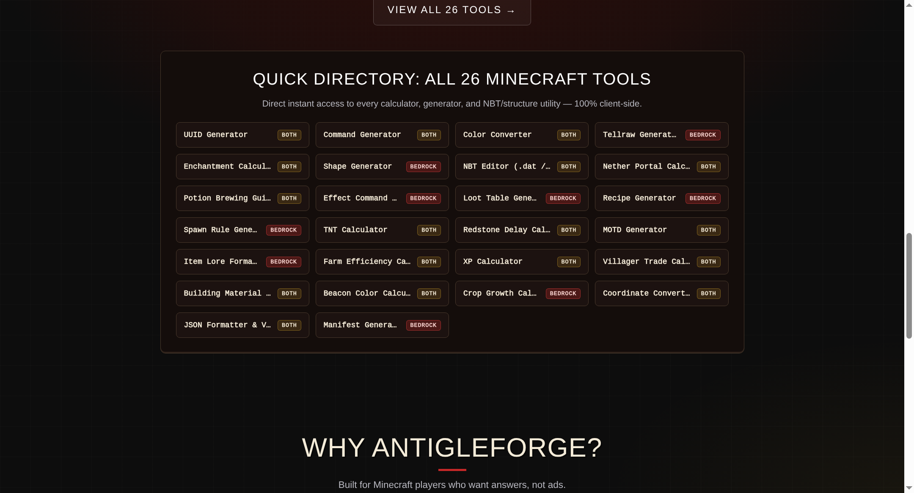
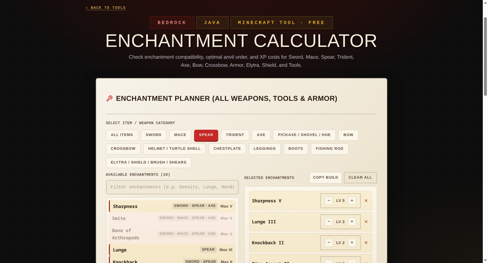
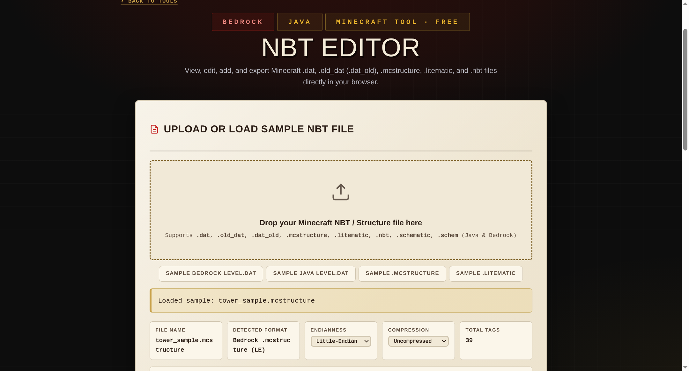

<div align="center">


# ⚒️ ANTIGLEFORGE

### **Build Smarter. Play Better.**
*A suite of 26 free, instant, and 100% client-side Minecraft Bedrock & Java Edition utilities engineered for zero latency, zero tracking, and zero server uploads.*

[](https://antigleforge.pages.dev/)
[](https://antigleforge.pages.dev/tools)
[](#5-tech-stack)
[](#4-key-features)
[](./LICENSE)

[🌐 **Explore Live Site**](https://antigleforge.pages.dev/) · [🧰 **Browse All 26 Tools**](https://antigleforge.pages.dev/tools) · [📺 **YouTube (@notgamingplayz)**](https://youtube.com/@notgamingplayz) · [📸 **Instagram (@antigle_official)**](https://www.instagram.com/antigle_official/)

</div>

---

## 1. 📖 Project Overview

**AntigleForge** is a high-performance, privacy-first web toolkit purpose-built for **Minecraft Bedrock Edition** and **Java Edition** players, technical builders, server owners, and add-on creators.

### 🎯 The Problem It Solves
Most existing Minecraft utility websites suffer from three major flaws:
1. **Intrusive Ad Clutter & Heavy Tracking:** Bloated third-party ad networks slow down mobile browsers and drain battery on Android devices.
2. **Desktop-Only Workflows:** Many calculators and file editors are unusable on mobile touchscreens where the majority of Minecraft Bedrock players play.
3. **Fragmented or Outdated Tooling:** Creators have to jump across a dozen websites to edit `.mcstructure` / `.litematic` / `level.dat` NBT files, generate 3D shapes, build `manifest.json` packs, or calculate optimal anvil enchantment trees for modern 1.21+ weapons like the **Mace** and **Spear**.

### 💡 The AntigleForge Solution
AntigleForge consolidates **26 specialized Minecraft calculators, generators, converters, and binary structure/NBT editors** into a single, cohesive **"Paper on Dark Forge"** interface (`#0D0D0D` dark forge grid paired with high-contrast `#F2EAD9` parchment workspaces). Every calculation, 3D WebGL render, GZip decompression, and binary NBT serialization happens **100% locally inside your browser tab**—with zero backend delays, zero accounts, and zero file uploads.

---

## 2. 🖥️ Live Demo & Screenshots

🔗 **Production Deployment:** [**https://antigleforge.pages.dev/**](https://antigleforge.pages.dev/)

### Homepage Hero & Featured Tools (`Paper on Dark Forge` UI)


### Quick Directory Hub & Accessible FAQ Accordion


### Upgraded Enchantment Calculator (Sword, Mace, Spear, Trident, Armor & Optimal Anvil Order)


### Client-Side Binary NBT & Structure Editor (`.dat`, `.old_dat`, `.mcstructure`, `.litematic`)


---

## 3. ✨ Key Features

### 🛠️ Complete 26-Tool Minecraft Suite
* **🧬 Binary NBT & Structure File Tools:**
  * **NBT Editor (`tools/nbt-editor.html`):** Inspect, search, edit inline values, add/delete tags, swap structure palette blocks in one click, and re-export binary `.dat` (Java GZip & Bedrock 8-byte header `level.dat`), `.old_dat` (`.dat_old`), `.mcstructure`, `.litematic`, `.nbt`, `.schematic`, and `.schem` files.
  * **3D Shape Generator (`tools/shape-generator.html`):** Interactive Three.js 3D voxel preview for 9 geometric shapes (Circle, Oval, Rectangle, Equilateral/Right Triangle, Parallelogram, Star, Diamond, Hexagon) with direct Bedrock `.mcstructure` and PNG export.
  * **Building Material Calculator (`tools/building-material-calculator.html`):** Upload existing `.mcstructure` or `.litematic` files to count exact blocks, stacks, shulker boxes, and double chests—or generate and export 3D shapes (Cuboid, Hollow Cuboid, Walls, Floor, Sphere, Dome, Cylinder, Stepped Pyramid) as `.mcstructure` and `.litematic`.
* **⚔️ Combat, Enchanting & Gameplay Calculators:**
  * **Enchantment Calculator (`tools/enchantment-calculator.html`):** Supports all 15 weapon, armor, tool, and utility categories—including **Mace** (`Density V`, `Breach IV`, `Wind Burst III`), **Spear** (`Lunge III`, `Sharpness V`, `Looting III`, `Fire Aspect II`, `Knockback II`), **Trident**, **Axe**, **Sword**, **Bow**, **Crossbow**, **Helmet/Chestplate/Leggings/Boots**, **Fishing Rod**, and **Elytra/Shield/Brush/Shears**—with automatic conflict detection and optimal anvil step ordering.
  * **XP Calculator, Villager Trade Calculator & Potion Brewing Guide:** Calculate exact XP levels, cure/Hero of the Village emerald discounts, and complete brewing recipes.
* **📐 Technical Minecraft & Redstone Calculators:**
  * **Nether Portal & Coordinate Converters:** Link Overworld/Nether portals and convert block coordinates into chunk (`16×16`) and region (`r.x.z.mca`) coordinates.
  * **Farm Efficiency, Crop Growth, Redstone Delay, TNT Blast & Beacon Color Calculators:** Plan AFK storage capacity, repeater tick delays, blast resistance, and 6-layer stained-glass beacon beam mixes.
* **📦 Bedrock Add-On & Server Generators:**
  * **Manifest, Loot Table, Crafting Recipe & Spawn Rule Generators:** Build valid Bedrock behavior/resource pack JSON files with instant UUID v4 generation.
  * **Command Generator, Effect Builder, Tellraw Generator, Item Lore Formatter, MOTD Generator, Color Converter & JSON Formatter:** Visual builders for complex commands and chat formatting with zero syntax memorization.

### 🎨 "Paper on Dark Forge" Design System & UX Architecture
* **High-Contrast Dual-Surface Theme (`theme.css` + `tool-panel.css`):** Combines a dark cyberpunk/forge outer grid (`#0D0D0D`, `#C62828` crimson, `#E8B32D` gold) with warm parchment inner tool cards (`#F2EAD9` background, `#2A1C14` ink text) that exceed WCAG 2.1 AA contrast ratios (`>= 5.5:1` on primary CTAs and `>= 8.6:1` on muted copy).
* **Single-Source Shared Components (`assets/js/components.js`):** Dynamically injects and synchronizes the sticky navigation bar, multi-column footer, and accessible FAQ accordion (`aria-expanded` / `aria-controls`) across all 32 HTML pages from a single file.
* **Adaptive Visual Mode vs. Performance Mode (`mode.html` & `assets/js/performance.js`):** Monitors frame timing and lets low-end mobile devices switch to a lightweight, zero-animation Performance Mode without losing active tool inputs.

### 🚀 Lighthouse 100/100 Engineering (Performance, A11y, Best Practices, SEO)
* **Zero Layout Shift (`CLS = 0.000`):** Uses `@font-face` metric overrides (`size-adjust`, `ascent-override`, `descent-override`) for `Anton`, `Oswald`, and `Courier Prime`, non-render-blocking font stylesheets, and explicit `width`/`height` attributes on every `<svg>`.
* **Technical SEO & Structured Data:** Strict `<h1>` → `<h2>` → `<h3>` DOM outline across all 32 pages, homepage **Quick Directory** linking all 26 utilities to eliminate orphan pages, `@graph` `JSON-LD` (`WebSite`, `SoftwareApplication`, `FAQPage`), `robots.txt`, and `sitemap.xml`.
* **Hardened Edge Security (`_headers`):** Enforces `Content-Security-Policy`, `Strict-Transport-Security` (HSTS preload), `X-Frame-Options: DENY`, `X-Content-Type-Options: nosniff`, `Permissions-Policy`, and 1-year `immutable` asset caching on Cloudflare Pages.

---

## 4. 🧰 Tech Stack

| Layer / Category | Technology / Standard | Purpose in AntigleForge |
| :--- | :--- | :--- |
| **Frontend Markup** | HTML5 (Semantic MPA + ARIA 1.2) | 32 standalone, crawlable pages with strict `<h1>`–`<h3>` hierarchy and screen-reader landmarks |
| **Styling & Design Tokens** | Vanilla CSS3 (`theme.css`, `tool-panel.css`) | Custom 8pt token system, fluid `clamp()` typography, responsive CSS Grid/Flexbox, and Paper-on-Dark contrast layer |
| **Core Logic & State** | Vanilla ES6+ JavaScript (`components.js`, `main.js`, `performance.js`) | Zero-framework DOM rendering, shared header/footer/FAQ injection, fuzzy Levenshtein tool search, and adaptive FPS mode |
| **Binary Parsing & Compression** | `DataView`, `BigInt64`, `DecompressionStream` / `CompressionStream` | Client-side Little-Endian & Big-Endian NBT parsing/serialization and GZip/Zlib decompression for `.dat`, `.old_dat`, `.mcstructure`, and `.litematic` |
| **3D Graphics Engine** | Three.js (`v0.160.0` ES Module + `OrbitControls`) | Hardware-accelerated 3D voxel preview and PNG snapshot export in `tools/shape-generator.html` |
| **Backend & Database** | **None (100% Serverless Client-Side)** | Zero server costs, zero cold starts, and complete user data privacy (all processing runs in browser memory) |
| **Build & Hosting** | Node.js (`minify.js`) + Cloudflare Pages (`_headers`) | Optional zero-dependency JS/CSS minifier and global edge CDN delivery with HTTP security headers |

---

## 5. 🚀 Getting Started / Installation Guide

AntigleForge is a zero-dependency static web application. It runs out of the box on any static file server without requiring heavy `npm install` node_modules trees.

### Prerequisites
* **Git** (to clone the repository)
* **Python 3.x** or **Node.js (v18+)** (to run a local static development server and optional minifier)

### Step 1: Clone the Repository
```bash
git clone https://github.com/mukund-buddy/antigleforge.git
cd "antigleforge"
```

### Step 2: Install Dependencies (Optional)
No external runtime packages are required. If you use Node.js tooling for local serving or minification:
```bash
# No third-party npm packages required; verify Node.js is available
node -v
```

### Step 3: Environment Variables Setup (Optional)
AntigleForge runs 100% client-side and requires **no API keys or secrets** in production. If you wrap it in a custom deployment pipeline or local preview runner, you can create a `.env.example` / `.env` file with the following format:
```ini
# .env.example — Local Preview & Deployment Configuration
PORT=8080
PUBLIC_SITE_URL=https://antigleforge.pages.dev
CF_PAGES_BRANCH=main
```

### Step 4: Run the Local Development Server
Start any static HTTP server from the repository root:

```bash
# Option A: Using Python 3 (built-in)
python3 -m http.server 8080

# Option B: Using Node.js npx serve
npx serve . -l 8080
```
Open [**http://localhost:8080**](http://localhost:8080) in your browser.

### Step 5: Optional Production Minification
To generate minified CSS and JS bundles inside `./min/`:
```bash
# Generate minified assets and view compression stats
node minify.js

# Apply minified paths to HTML files (creates .bak backups)
node minify.js --apply

# Restore original unminified paths
node minify.js --restore
```

---

## 6. 📂 Project Structure

```text
AntigleForge/
├── index.html                          # Homepage (Hero, 7 Featured Cards, 26-Tool Quick Directory, JSON-LD)
├── tools.html                          # Searchable & filterable catalog of all 26 Minecraft tools
├── mode.html                           # Visual Mode vs. Performance Mode switcher
├── about.html                          # Project mission, creator credits & Mojang disclaimer
├── privacy.html                        # Zero-collection privacy policy
├── terms.html                          # Terms of use
├── _headers                            # Cloudflare Pages HTTP security (CSP, HSTS) & immutable cache rules
├── robots.txt                          # Crawler directives pointing to sitemap.xml
├── sitemap.xml                         # Complete XML sitemap covering all 32 canonical routes
├── minify.js                           # Zero-dependency Node.js CSS/JS minifier utility
├── ROADMAP.md                          # Product direction, research criteria & engineering guardrails
├── LICENSE                             # MIT License
├── public/                             # Mirrored static deployment configs (_headers, robots.txt, sitemap.xml)
├── assets/
│   ├── css/
│   │   ├── theme.css                   # Master "Paper on Dark Forge" stylesheet & 8pt design tokens
│   │   └── tool-panel.css              # Parchment panel contrast normalization layer for tool pages
│   ├── images/
│   │   ├── logo-mark.svg               # Pixel-art AntigleForge emblem
│   │   ├── logo.png                    # Open Graph / social preview emblem
│   │   ├── blocks/                     # 33 Minecraft block textures for 3D voxel previews
│   │   └── presentation/               # High-resolution UI screenshots for documentation
│   │       ├── hero-preview.png
│   │       ├── tools-directory.png
│   │       ├── enchantment-calculator.png
│   │       └── nbt-editor.png
│   └── js/
│       ├── components.js               # Single source of truth for Header, Footer & FAQ injection
│       ├── main.js                     # Core utilities: clipboard, toast notifications, UUID v4, scroll reveal
│       ├── performance.js              # Adaptive FPS monitor & Performance Mode state manager
│       └── tools/
│           └── command-generator.js    # Command syntax definitions & parameter builders
└── tools/                              # 26 Standalone Client-Side Minecraft Utilities
    ├── beacon-color-calculator.html    # 6-layer stained glass beacon beam color mixer
    ├── building-material-calculator.html # Structure uploader (.mcstructure/.litematic) & 3D shape exporter
    ├── color-converter.html            # Minecraft § section code, Hex & RGB converter
    ├── command-generator.html          # Visual /give, /tp, /effect, /fill & /summon builder
    ├── coordinate-converter.html       # Block, chunk & region (r.x.z.mca) coordinate converter
    ├── crop-growth-calculator.html     # Crop harvest timer & bone meal estimator
    ├── effect-command-builder.html     # Bedrock & Java /effect command generator
    ├── enchantment-calculator.html     # All-item enchantment compatibility & optimal anvil XP planner
    ├── farm-efficiency-calculator.html # Items/hour, shulker/chest storage & AFK timer
    ├── item-lore-formatter.html        # Custom colored item lore & /give generator
    ├── json-formatter.html             # Add-on JSON formatter, minifier & line/column error validator
    ├── loot-table-generator.html       # Bedrock behavior pack loot table JSON builder
    ├── manifest-generator.html         # Bedrock resource/behavior/script module manifest.json generator
    ├── motd-generator.html             # Live server MOTD color & formatting previewer
    ├── nbt-editor.html                 # Binary NBT editor (.dat, .old_dat, .mcstructure, .litematic, .nbt)
    ├── nether-portal-calculator.html   # Overworld <-> Nether 8:1 coordinate linker
    ├── potion-brewing-guide.html       # Interactive brewing recipe, duration & modifier reference
    ├── recipe-generator.html           # Shaped & shapeless Bedrock crafting recipe JSON builder
    ├── redstone-delay-calculator.html  # Redstone tick, game tick & repeater chain calculator
    ├── shape-generator.html            # Three.js 3D voxel shape builder with .mcstructure export
    ├── spawn-rule-generator.html       # Bedrock mob spawn rules JSON generator
    ├── tellraw-generator.html          # Rich clickable rawtext / tellraw JSON builder
    ├── tnt-calculator.html             # Blast radius, block resistance & explosion calculator
    ├── uuid-generator.html             # Bulk cryptographic UUID v4 generator with history
    ├── villager-trade-calculator.html  # Cure discount & Hero of the Village emerald calculator
    └── xp-calculator.html              # Level XP, death penalty & Mending durability calculator
```

---

## 7. 🤝 Contributing & Adding New Tools

Contributions, bug reports, and new Minecraft utility ideas are welcome! Before proposing or building a new tool, please review [`ROADMAP.md`](./ROADMAP.md) to ensure it aligns with our core principles (**100% client-side execution, zero persistent user data, mobile-first touch usability, and strict XSS/DOM safety**).

### Workflow for Adding a New Tool
1. **Fork & Branch:** Fork the repository and create a feature branch (`git checkout -b feat/new-tool-name`).
2. **Create the Tool Page:** Copy an existing template from `tools/` (e.g., `tools/coordinate-converter.html`) to `tools/new-tool-name.html`.
3. **Use Shared Components:** Do **not** hardcode `<header>` or `<footer>` markup. Load `../assets/js/performance.js?v=5`, `../assets/js/main.js?v=5`, and `../assets/js/components.js?v=5` at the end of `<body>`, and initialize the page's FAQ accordion via `AntigleComponents.init([...])`.
4. **Register the Tool:**
   * Add a tool card to `tools.html` with appropriate `data-tool`, `data-tags`, `data-category`, and `data-edition` attributes.
   * Add a link pill inside the `.tools-directory-grid` in `index.html`.
   * Add the canonical URL to `sitemap.xml` (and `public/sitemap.xml`).
5. **Submit a Pull Request:** Verify zero console errors, WCAG 2.1 AA contrast compliance, and mobile responsiveness at `375px` width before opening a PR.

---

## 8. 📜 License & Disclaimer

Distributed under the **MIT License**. See [`LICENSE`](./LICENSE) for full license text.

```text
MIT License — Copyright (c) 2026 Mukund (AntigleForge)
Permission is hereby granted, free of charge, to any person obtaining a copy of this software
and associated documentation files, to deal in the Software without restriction, including
without limitation the rights to use, copy, modify, merge, publish, distribute, sublicense,
and/or sell copies of the Software.
```

> **Disclaimer:** AntigleForge is an independent, unofficial fan project and is not affiliated with, approved by, or endorsed by **Mojang Studios** or **Microsoft**. *Minecraft* is a trademark of Mojang Synergies AB.
